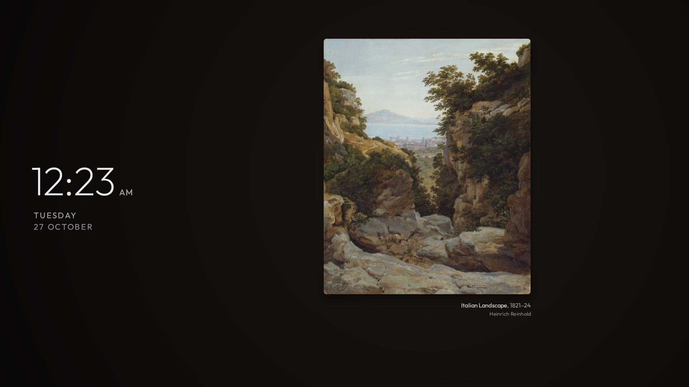
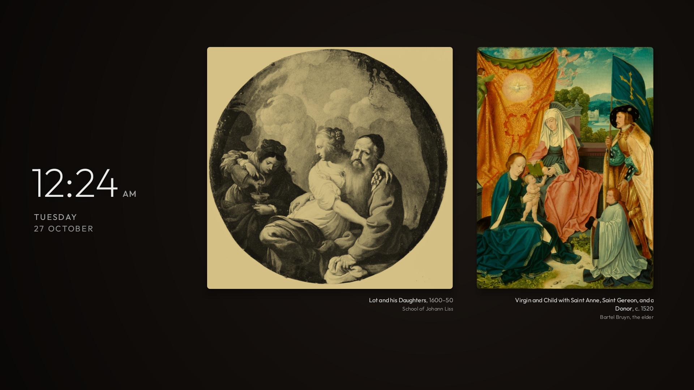

# Artellis

**A screensaver for Android TV and Google TV that turns your screen into a small museum wall.**

Public-domain paintings from the [Art Institute of Chicago](https://www.artic.edu/open-access) and
[The Met](https://www.metmuseum.org/hubs/open-access), hung one to three at a time in themed walls, with
museum-style labels and a large, quiet clock. A new wall every five minutes, new paintings every day. No
account, no photos to copy, no ads, no tracking.


<table>
  <tr>
    <td width="50%"><br><em>A landscape on a wall of its own</em></td>
    <td width="50%"><br><em>Evening: the wall darkens and warms</em></td>
  </tr>
</table>

## What you see

- **A themed wall.** One to three paintings from one place and period: Dutch Golden Age, French
  Impressionism, the Italian Renaissance and others. Three portraits side by side, two squarer works, or one
  landscape on its own. Paintings are never cropped and never hung too small to enjoy.
- **Museum labels.** Under each painting, aligned to its right edge: *title, year* and the artist, as the
  museums write them ("c. 1665" means about 1665).
- **A large clock.** The left quarter of the screen: time (09:41, or 24-hour if the TV uses it), weekday and date in [Outfit](https://fonts.google.com/specimen/Outfit),
  and, while music plays, the song and artist.
- **A wall that follows the day.** A soft spotlit gradient: warm stone in the morning, neutral taupe at
  midday, amber-brown in the late afternoon, near-black with an amber tint at night. Always dark enough for
  the text, never blue at night.
- **Warm light at night.** Between the hours you choose (9 PM to 7 AM by default, in 30-minute steps) the
  paintings get warmer and slightly dimmer, fading in and out over half an hour. On by default; switch it off
  in the settings if you want the colours untouched.
- **Burn-in safe.** The wall changes every five minutes and the clock drifts a little every minute.

## Install

> **New to this?** Open this folder in Claude, ChatGPT or another AI assistant and ask:
> *"Help me install Artellis on my TV."* It will walk you through [SETUP.md](SETUP.md) one step at a time.

**Your TV** needs Android TV or Google TV, Android 8.0 or newer. Fire TV runs Amazon's version of Android:
it is untested but may work. Samsung (Tizen), LG (webOS) and Roku TVs can't run Artellis.

**You need** a computer on the same network with [adb](https://developer.android.com/tools/releases/platform-tools),
and **network debugging** switched on on the TV. [SETUP.md](SETUP.md) shows each step, including where the
menus are on different brands.

### From a release (no build)

Download `artellis-<version>.apk` from [Releases](../../releases), then:

```powershell
scripts\install.ps1 -TvHost 192.168.1.50 -Apk artellis-1.0.0.apk         # Windows
```
```sh
TV_HOST=192.168.1.50 APK=artellis-1.0.0.apk scripts/install.sh          # macOS, Linux
```

Accept the debugging prompt on the TV the first time. The script installs Artellis, lets it show the song
that is playing, makes it the screensaver and starts it. Your previous screensaver is remembered.

**Updates:** Artellis doesn't check for updates itself (it only talks to the museums). To hear about new
versions, choose **Watch > Custom > Releases** at the top of this page, then run the same command with the
new APK. Your paintings and settings are kept.

### From source

JDK 17 and the Android SDK (platform 34). Then the same scripts without the APK: they build first.

```powershell
scripts\install.ps1 -TvHost 192.168.1.50
```
```sh
TV_HOST=192.168.1.50 scripts/install.sh
```

### More

| | Windows | macOS, Linux |
|---|---|---|
| Warm light at night off (or `on`) | `scripts\install.ps1 -TvHost <ip> -NightFilter off` | `TV_HOST=<ip> scripts/install.sh --night-filter off` |
| Previous screensaver back | `scripts\install.ps1 -TvHost <ip> -Off` | `TV_HOST=<ip> scripts/install.sh --off` |
| Settings tile in the app list (Google TV) | `scripts\install.ps1 -TvHost <ip> -SettingsTile on` | `TV_HOST=<ip> scripts/install.sh --settings-tile on` |
| Remove Artellis | `scripts\install.ps1 -TvHost <ip> -Uninstall` | `TV_HOST=<ip> scripts/install.sh --uninstall` |

If the screensaver you had before is gone or switched off, `-Off` returns the TV to its own default.

**When you're done, turn USB / network debugging off again on the TV.** Left on, anyone on your network
could connect to it.

### What install changes

Only three things, and `-Off` / `-Uninstall` undo them:

1. **Installs one app,** Artellis. No other app is changed, disabled or removed, and nothing system-wide.
2. **Lets Artellis see what's playing,** for the song line (the notification-listener permission; it reads
   no notifications).
3. **Makes Artellis the screensaver** and switches the screensaver on. The previous choice is saved on the TV
   and in a small `artellis-restore-<tv>.txt` next to the scripts, so `-Off` can put it back.

The idle time before the screensaver starts is the TV's own setting and isn't touched. No backup of the TV
is needed.

## Settings

Open **Settings > Device Preferences > Screen saver**, select **Artellis** and open its settings. The page says
what Artellis is, where the paintings come from and how much is saved, and holds its one setting: **warm light at
night**, with its start and end time. On a time, press OK to change it, up/down or left/right to move it by
half an hour, and OK again to finish.

Google TV and Fire TV don't show settings for other screensavers. There, show an **Artellis settings** tile
in the app list with `-SettingsTile on` (`--settings-tile on`), or switch warm light straight from the
computer with `-NightFilter off` / `on`. The tile is hidden on every TV until you ask for it.

## How it works

- **Only while the screensaver runs,** or while its settings page is open on a TV with no paintings yet (it
  fetches one wall for the preview). No background service, no boot receiver, nothing running otherwise.
- **About 15 walls a day.** When the screensaver starts and today's walls aren't all there, it fetches the
  rest: a theme, a random page of that museum's public-domain paintings, the best-fitting one to three.
- **Saved for offline.** Each painting is saved already scaled for its place on your screen, so it shows
  even when the internet is down.
- **No repeats for weeks.** The last 1,500 works shown are remembered.

### Storage

About 60 paintings at most, never more than **40 MB**; the oldest walls are deleted first. Nothing is
downloaded while the TV has under **500 MB** free. Settings > Apps > Artellis > Clear storage empties it.

### Privacy and network

- Artellis talks only to `api.artic.edu`, `www.artic.edu`, `collectionapi.metmuseum.org` and
  `images.metmuseum.org`. Requests carry no account, location or device identifiers. The Art Institute is
  sent the app's name in an `AIC-User-Agent` header, as its API asks.
- No analytics, ads or telemetry.
- **Song line:** Android only lets an app see what is playing if it is allowed as a notification listener,
  so the install script allows that. Artellis reads no notifications, only the title and artist of the
  media playing. Without it the song line simply doesn't show.

## Compatibility

Android TV and Google TV, Android 8.0 (API 26) and up. Fire TV is untested but may work. Some TV makers hide
third-party screensavers in their settings; the install script sets Artellis over adb, which works regardless.

## Development

```sh
./gradlew testReleaseUnitTest assembleRelease
```

The wall layout (`Hang`), colours (`Palette`) and image sizing (`Fit`) are plain Java with unit tests in
`app/src/test`. Logs: `adb shell logcat -d -s Artellis`.

**Release signing.** Create a key once and keep it safe (lose it and users can't update):

```sh
keytool -genkeypair -v -keystore artellis-release.jks -alias artellis -keyalg RSA -keysize 4096 -validity 10000
```

Then a `keystore.properties` next to `settings.gradle` (both are git-ignored):

```properties
storeFile=artellis-release.jks
storePassword=...
keyAlias=artellis
keyPassword=...
```

Without it, release builds are signed with your debug key: fine for your own TV.

## Support

Artellis is free and always will be. If it brightens your living room, you can
[buy me a coffee ☕](https://paypal.me/fijea).
<!-- - [GitHub Sponsors](https://github.com/sponsors/fijea-studio) — add once the Sponsors profile is approved -->

Bug reports and ideas are just as welcome: open an [issue](../../issues).

## Credits and licences

- Paintings: public-domain works from the **Art Institute of Chicago** (API data
  [CC0](https://www.artic.edu/open-access/public-api)) and **The Metropolitan Museum of Art**
  ([Open Access](https://www.metmuseum.org/hubs/open-access), CC0). Artellis is not affiliated with either museum.
- Font: **Outfit**, SIL Open Font License 1.1 ([FONT-LICENSE-OFL.txt](FONT-LICENSE-OFL.txt)).
- Code: [MIT](LICENSE), written with the help of Claude.
